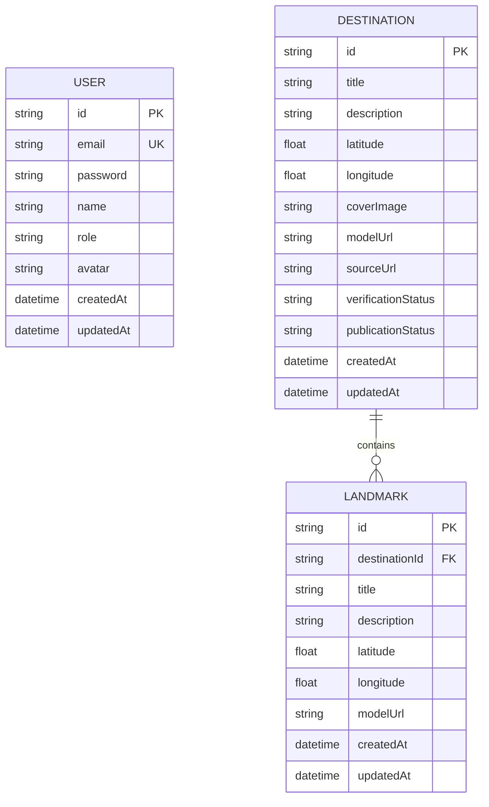
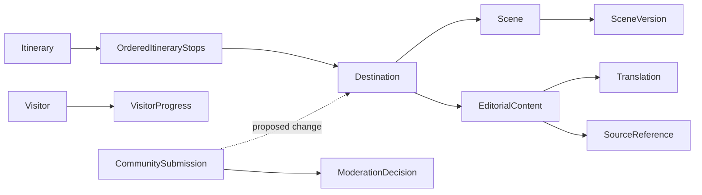

# Product Scope & Domain Model — Cù Lao Giêng 3D Explorer

> Cập nhật: 2026-10-29
> Trạng thái: **Vision và quyết định nghiệp vụ đã xác nhận; domain/database mục tiêu chưa triển khai**.
> Phạm vi: phân biệt hiện trạng trong repository với mục tiêu sản phẩm được thống nhất trong yêu cầu.

## 1. Vision

Xây dựng nền tảng số chuyên về du lịch, văn hóa và di sản Cù Lao Giêng, kết hợp website thông tin, bản đồ khu vực, khám phá 3D theo địa điểm và nội dung có nguồn tư liệu đáng tin cậy.

Giá trị cốt lõi: **văn hóa, du lịch, giáo dục và cộng đồng**.

Đối tượng phục vụ: khách du lịch, học sinh/sinh viên, khách quốc tế, nhà nghiên cứu và cộng đồng địa phương.

Phạm vi địa lý là toàn khu vực Cù Lao Giêng. Danh mục địa điểm chính thức phải được đội ngũ biên tập xác minh. Nội dung hướng tới tiếng Việt và tiếng Anh; nguồn tư liệu là bắt buộc đối với nội dung lịch sử, văn hóa và di sản.

## 2. Current State — hiện trạng có bằng chứng trong mã

Đây là kết luận từ mã nguồn/cấu hình. Trong lần cập nhật tài liệu này không chạy app hoặc test suite; do đó không khẳng định runtime hiện đang hoạt động.

| Hạng mục | Mức hiện tại | Bằng chứng / giới hạn |
|---|---|---|
| Bản đồ | Đã triển khai một phần trong mã | Mapbox hiển thị destination công khai lấy từ `GET /destinations`; có marker, thẻ chi tiết, điều hướng và thông báo khi danh sách rỗng. Token đọc từ `NEXT_PUBLIC_MAPBOX_TOKEN`. |
| Danh sách địa điểm | Có API đọc với cổng xuất bản | Prisma `Destination` và `Landmark`; service chỉ trả destination `VERIFIED` và `PUBLISHED`. Seed có 8 điểm đến cùng 7 landmark thuộc dataset mẫu An Giang/khu vực lân cận, mặc định `UNVERIFIED`/`DRAFT`, nên không xuất hiện trong API công khai sau khi đồng bộ schema. Chưa phải danh mục Cù Lao Giêng đã xác minh. |
| Đăng ký/đăng nhập | Có luồng frontend/backend trong mã | API register/login, JWT HS256 và hash mật khẩu scrypt; frontend giữ token trong localStorage. |
| Bảo vệ truy cập | Một phần | Khách chưa đăng nhập có thể mở `/map` và `/explore`; API `AuthGuard` tồn tại nhưng chưa được gắn vào các endpoint hiện có. |
| Scene 3D | Demo cơ bản | Một `WorldScene` dùng hình khối mẫu và một nhân vật capsule điều khiển WASD/Shift. Query `id` đổi tiêu đề nhưng chưa chọn scene theo destination. |
| Trang chủ | Chưa triển khai | `apps/web/app/page.tsx` chỉ render “Hello World”. |
| Nội dung biên tập, nguồn tư liệu, bản dịch và xuất bản | Cổng dữ liệu tối thiểu | Destination có URL nguồn tùy chọn và hai chuỗi trạng thái xác minh/xuất bản. Chưa có model nội dung, translation, source/citation theo claim, API duyệt hay CMS. |
| CMS Admin/Editor | Chưa thấy triển khai | Chưa có trang/module/API quản trị; role hiện tại không có `EDITOR`. |
| Tiến trình, hành trình, đề xuất cộng đồng | Chưa thấy triển khai | Không có model/API tương ứng; Zustand player store chỉ giữ tọa độ trong bộ nhớ. |
| AI Guide, NPC, nhiệm vụ/huy hiệu | Chưa triển khai | Có nút AI mẫu và prompt constant; chưa có luồng gọi dịch vụ AI hoặc domain module. |

Các vị trí đối chiếu chính: `apps/web/app/(protected)/map/page.tsx`, `apps/web/app/(protected)/explore/page.tsx`, `apps/web/three/scene/WorldScene.tsx`, `apps/web/three/character/PlayerController.tsx`, `apps/api/src/modules`, `apps/api/prisma/schema.prisma`.

## 3. Target State — phạm vi nghiệp vụ đã xác nhận

### Trong phạm vi sản phẩm/MVP mục tiêu

- Người dùng không cần đăng nhập để duyệt thông tin và khám phá.
- Bản đồ bao phủ Cù Lao Giêng; địa điểm chính thức được biên tập và xác minh.
- Website có thông tin du lịch, văn hóa, lịch sử và di sản bằng tiếng Việt/tiếng Anh.
- Nội dung văn hóa/lịch sử có liên kết nguồn tư liệu.
- Mỗi địa điểm được hỗ trợ có tối đa một scene 3D đang hoạt động; scene có quản lý phiên bản.
- Hành trình là danh sách destination có thứ tự, gợi ý theo chủ đề hoặc khu vực.
- Khách ẩn danh có thể lưu tiến trình tạm trên trình duyệt; tài khoản đăng nhập có thể đồng bộ tiến trình.
- Cộng đồng có thể đề xuất địa điểm, chỉnh sửa nội dung và bổ sung nguồn; đề xuất phải qua kiểm duyệt.
- CMS có hai vai trò: Editor soạn nội dung; Admin duyệt/xuất bản và quản lý hệ thống.
- Trạng thái xuất bản của từng ngôn ngữ được quản lý độc lập.

### Ngoài MVP hoặc chờ quyết định mới

- AI Guide thuộc giai đoạn sau.
- Nhiệm vụ và huy hiệu thuộc giai đoạn sau.
- NPC và tương tác nâng cao không phải yêu cầu MVP nếu chưa có quyết định nghiệp vụ mới.

### Tiêu chí chấp nhận ở mức sản phẩm

1. Người chưa đăng nhập xem bản đồ và mở nội dung khám phá; tiến trình ẩn danh được giữ trên trình duyệt.
2. Người đăng nhập có thể đồng bộ tiến trình.
3. Destination chính thức chỉ được xuất bản sau xác minh; vòng đời destination tuân theo trạng thái bên dưới.
4. Nội dung lịch sử/văn hóa đã xuất bản có nguồn tư liệu truy ngược được.
5. Bản dịch có trạng thái riêng; xuất bản tiếng Việt không tự động xuất bản tiếng Anh và ngược lại.
6. Thay đổi scene đã phát hành tạo phiên bản mới; phiên bản phát hành không bị mặc định sửa trực tiếp.
7. Đề xuất cộng đồng không thay đổi nội dung chính thức trước khi được kiểm duyệt.
8. Quyền Editor/Admin được phân biệt trong thao tác soạn, duyệt và xuất bản.

## 4. Ubiquitous Language và vòng đời

| Thuật ngữ | Nghĩa nghiệp vụ mục tiêu |
|---|---|
| Destination | Địa điểm du lịch/di sản chính thức trong phạm vi Cù Lao Giêng. |
| Editorial Content | Nội dung chính thức do đội ngũ biên tập quản lý, gắn với destination hoặc chủ đề liên quan. |
| Translation | Bản nội dung theo một ngôn ngữ; trạng thái xuất bản độc lập theo ngôn ngữ. |
| Source Reference | Tư liệu dùng để chứng minh nội dung; phải liên kết tới phần nội dung được hỗ trợ. |
| Scene | Trải nghiệm 3D đang hoạt động của một destination; có các phiên bản được quản lý. |
| Itinerary / Itinerary Stop | Hành trình có thứ tự và các destination được sắp xếp trong hành trình. |
| Visitor Progress | Tiến trình khám phá của khách ẩn danh trên browser hoặc tài khoản đã đăng nhập. |
| Community Submission | Đề xuất cần kiểm duyệt, không trực tiếp sửa dữ liệu chính thức. |
| Editor / Admin | Editor soạn; Admin duyệt, xuất bản và quản lý hệ thống. |

Destination có vòng đời đã chốt:

`DRAFT → VERIFIED → PUBLISHED → ARCHIVED`

Các loại nội dung và bản dịch cần vòng đời xuất bản phù hợp riêng; giá trị trạng thái cụ thể **chưa được chốt trong yêu cầu** và không nên tự dùng chung lifecycle của Destination. Scene cần versioning; scene version đã phát hành nên bất biến và thay đổi được phát hành thành version mới.

## 5. Bounded Context mục tiêu

Các context dưới đây là ranh giới nghiệp vụ mục tiêu, **không phải các module code đã tồn tại**:

1. **Destination & Heritage** — danh mục địa điểm, xác minh, thông tin địa lý và liên hệ di sản.
2. **Editorial & Knowledge** — nội dung chính thức, bản dịch, nguồn tư liệu và trạng thái xuất bản theo ngôn ngữ.
3. **3D Exploration** — scene, phiên bản scene và liên kết điểm tương tác với nội dung.
4. **Itinerary & Discovery** — hành trình có thứ tự, chủ đề/khu vực và gợi ý khám phá.
5. **Visitor Progress** — tiến trình ẩn danh trên browser và đồng bộ tiến trình tài khoản.
6. **Community Submissions** — đề xuất và trạng thái kiểm duyệt.
7. **Editorial Administration** — quyền Admin/Editor, duyệt, xuất bản và hoạt động quản trị.

Một modular monolith là **hướng tổ chức mục tiêu để xem xét**, không phải mô tả cấu trúc hiện tại. Chi tiết cách chia module, domain event và audit log vẫn cần thiết kế trước khi triển khai.

## 6. Database hiện tại và ERD

### Current — Prisma đang có

PostgreSQL schema và SQLite schema gồm ba model:

- `User`: id, email duy nhất, password hash, name, role, avatar tùy chọn, timestamps.
- `Destination`: id, title, description, latitude/longitude dạng Float, coverImage, modelUrl và sourceUrl tùy chọn, verificationStatus mặc định UNVERIFIED, publicationStatus mặc định DRAFT, timestamps.
- `Landmark`: nội dung và tọa độ, `destinationId` là foreign key tới Destination; xóa Destination thì cascade Landmark.
- Một Destination có nhiều Landmark. User hiện chưa có relation tới progress, submissions hoặc itinerary.
- Role PostgreSQL là `VISITOR`, `USER`, `ADMIN`; schema SQLite lưu role dạng String.
- Chưa có model translation/source/version, workflow xuất bản hoặc migration file trong `apps/api/prisma/migrations`; hai trạng thái Destination hiện là trường String, chưa có endpoint thay đổi trạng thái.

### Target — ERD khái niệm đề xuất

Sơ đồ dưới đây thể hiện các khái niệm và quan hệ cần được thiết kế để đáp ứng nghiệp vụ. Đây **không phải Prisma schema, migration hay database đã triển khai**; cardinality và tên bảng cuối cùng cần được xác nhận khi thiết kế dữ liệu.

Các ràng buộc chính của target: một scene đang hoạt động tối đa trên mỗi destination và nhiều phiên bản scene; Translation quản lý theo ngôn ngữ độc lập; source liên kết với nội dung cần chứng minh; ItineraryStop giữ thứ tự; VisitorProgress hỗ trợ cả khách ẩn danh lẫn tài khoản; CommunitySubmission chỉ cập nhật dữ liệu chính thức sau moderation.

## 7. Gap và câu hỏi mở

- Dataset mẫu hiện tại không phải danh mục Cù Lao Giêng được xác minh; cần xác định nguồn dữ liệu, quy trình biên tập và người có thẩm quyền xác nhận.
- Chưa chọn cách biểu diễn source/citation và granularity: nguồn gắn với bài, bản dịch hay từng claim.
- Chưa chốt workflow trạng thái cho Editorial Content và Translation.
- Chưa chốt quy tắc merge tiến trình local với tiến trình tài khoản.
- Chưa chốt retention, quyền riêng tư và mức định danh cho VisitorProgress ẩn danh.
- Chưa chốt quy trình kiểm duyệt, audit log và quyền Admin/Editor chi tiết.
- Chưa chốt công nghệ CMS, lưu trữ media/scene, hoặc cách lưu dữ liệu không gian.
- Khách ẩn danh đã mở được `/explore`, nhưng tiến trình ẩn danh chưa được lưu; scene theo destination vẫn là demo.

## 8. Roadmap đề xuất — không có deadline cam kết

Thứ tự dưới đây là đề xuất dựa trên phụ thuộc; chưa phải lịch đã cam kết.

1. Ổn định luồng map/API/auth hiện có, chốt cách cho phép anonymous exploration và cấu hình môi trường.
2. Thiết kế domain/schema mục tiêu cho destination, nội dung, translation, nguồn tư liệu, scene version và xuất bản; không áp dụng schema này vào database trong bước tài liệu.
3. Xây trải nghiệm website thực tế và nội dung biên tập song ngữ có nguồn; triển khai quyền/quy trình CMS để quản lý nội dung.
4. Chọn một nhóm destination ưu tiên và xây scene 3D có versioning, liên kết tương tác với nội dung đã xác minh.
5. Hoàn thiện itinerary, tiến trình ẩn danh/đăng nhập và community submission/moderation.
6. Đánh giá AI Guide sau khi nội dung chính thức và nguồn tư liệu đủ tin cậy. NPC, nhiệm vụ và huy hiệu chờ quyết định giai đoạn sau.

Không gán tỷ lệ hoàn thành, deadline hay milestone cho các mục trên.
