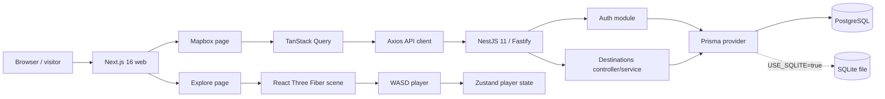

# Kiến trúc hệ thống — hiện tại và mục tiêu

> Cập nhật: 2026-10-29
> Trạng thái: mô tả code hiện hành dựa trên source/config; kiến trúc nghiệp vụ mục tiêu được tách riêng. Không khẳng định runtime đã được kiểm thử trong lần cập nhật tài liệu này.

## 1. Current Architecture

Repository là monorepo pnpm/Turborepo gồm Next.js web, NestJS API và hai shared packages. API dùng Fastify adapter. Không có bằng chứng về microservices; các module API hiện tại là `auth`, `users` và `destinations`.



### Frontend

- Route hiện có: `/`, `/login`, `/register`, `/map`, `/explore`.
- `/map` lấy dữ liệu qua `useDestinations` → `destinationsApi` → Axios → `GET /destinations`; destination đủ điều kiện có thể mở panel và điều hướng sang `/explore?id=...`. Danh sách rỗng có thông báo riêng.
- `NEXT_PUBLIC_API_URL` cấu hình API base URL; Mapbox token đọc từ `NEXT_PUBLIC_MAPBOX_TOKEN`.
- `/explore` tải `WorldScene` động với SSR tắt. Scene dùng bầu trời, grid, sàn, hình khối mẫu, player capsule và OrbitControls.
- PlayerController cập nhật tọa độ vào Zustand; chưa có persistence hoặc đồng bộ API tiến trình.
- Query destination `id` hiện dùng cho tiêu đề; `WorldScene` không nhận destination data và không tải scene theo id. Tiêu đề ghi rõ đây là cảnh 3D minh họa.
- Trang `/` hiện là placeholder “Hello World”.

### Authentication và quyền truy cập

- `POST /auth/register` và `POST /auth/login` trả thông tin user đã rút gọn cùng JWT.
- Frontend lưu token trong localStorage và Axios gửi `Authorization: Bearer`.
- JWT được ký HS256 bằng Node `crypto`, TTL mặc định 24 giờ; `JWT_SECRET` bắt buộc có khi khởi động API.
- AuthHydration cho khách chưa đăng nhập mở `/map` và `/explore`; người đã đăng nhập truy cập `/login` hoặc `/register` được chuyển về `/map`. Có `AuthGuard` ở API nhưng chưa được áp dụng lên endpoint hiện tại.
- Khách ẩn danh xem được cảnh minh họa; tiến trình cục bộ và đồng bộ tài khoản chưa được triển khai.

### API và dữ liệu

- `AppModule` đăng ký Prisma, Auth, Users và Destinations.
- Controller hiện có: auth register/login; destination list/detail.
- `UsersModule` hiện chỉ có service, chưa có users controller.
- Prisma provider mặc định PostgreSQL; khi `USE_SQLITE=true` chọn SQLite service lưu trong `apps/api/dev.db` (hoặc tên file `SQLITE_DATABASE_FILE` trong `apps/api`) và seed dữ liệu mẫu khi danh sách destination còn trống. Prisma Client cần được sinh lại sau mỗi lần đổi provider; Playwright E2E dùng `apps/api/e2e.db` riêng.
- Compose khai báo PostGIS và Redis. Schema có User, Destination, Landmark; tọa độ là Float. Destination có `sourceUrl` tùy chọn, `verificationStatus` mặc định `UNVERIFIED` và `publicationStatus` mặc định `DRAFT` trong cả schema PostgreSQL/SQLite. API công khai chỉ đọc hồ sơ `VERIFIED` và `PUBLISHED`. Mỗi database đích cần được sao lưu và đồng bộ schema riêng; chưa có API biên tập/duyệt. Không thấy PostGIS geometry/query hoặc Redis client tích hợp.
- Chi tiết schema hiện tại và ERD khái niệm mục tiêu: [Product Scope & Domain](./PRODUCT_SCOPE_AND_DOMAIN.md).

## 2. Runtime Flow có trong code

### Map → API

```text
MapPage
  → useDestinations()
  → destinationsApi.getAll()
  → Axios GET /destinations
  → DestinationsController.findAll()
  → DestinationsService.findAll()
  → Prisma destination.findMany(where: VERIFIED + PUBLISHED, include: landmarks)
```

### Auth

```text
Login/Register form
  → useAuth mutation
  → authApi
  → POST /auth/login | POST /auth/register
  → AuthService + Prisma User
  → { user: { id, email, name, role }, token }
  → Zustand/localStorage
```

### 3D demo

```text
/explore?id={destinationId}
  → dynamic import WorldScene (ssr: false)
  → PlayerController reads keyboard events
  → useFrame moves capsule mesh
  → Zustand stores [x, y, z]
```

Các flow trên là đường đi trong source; tài liệu này không xác nhận chúng vừa được chạy end-to-end.

## 3. Target Architecture — nghiệp vụ đã chốt, code chưa có

Target là nền tảng Cù Lao Giêng với anonymous browse/progress, nội dung biên tập Việt/Anh có nguồn, scene versioned, itinerary và moderated community submissions. Bounded Context mục tiêu là:

- Destination & Heritage
- Editorial & Knowledge
- 3D Exploration
- Itinerary & Discovery
- Visitor Progress
- Community Submissions
- Editorial Administration

Các context là ranh giới nghiệp vụ mục tiêu; chúng chưa tương ứng một-một với NestJS modules hiện có. Modular monolith là hướng tổ chức để xem xét, không phải kiến trúc đã triển khai. AI Guide và nhiệm vụ/huy hiệu thuộc giai đoạn sau; NPC nâng cao không bắt buộc nếu chưa có quyết định mới.

Xem [Product Scope & Domain](./PRODUCT_SCOPE_AND_DOMAIN.md) về quy tắc nghiệp vụ, vòng đời, ERD mục tiêu và roadmap.
